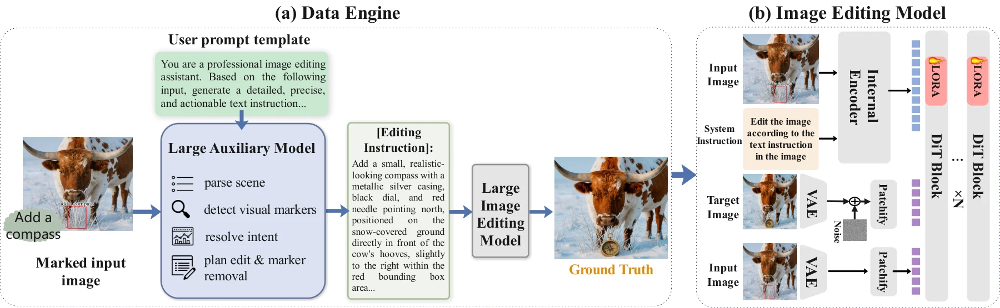
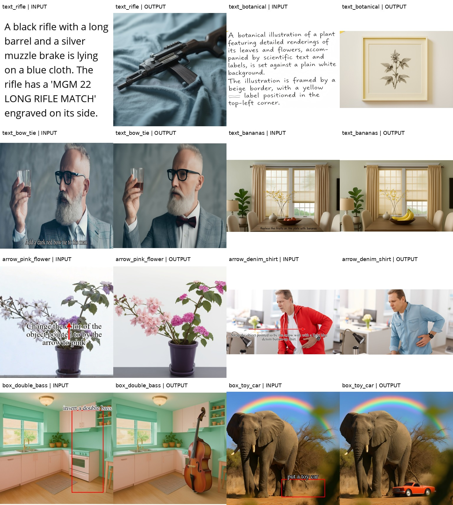

# Siphon

## Internalize External Competence for Visual Instruction Editing

**NeurIPS 2026**

[Project page](https://wenjunhuang94.github.io/Siphon/) | [Paper (PDF)](docs/Siphon.pdf) | [OpenReview](https://openreview.net/forum?id=mKfQzVpQIM) | [NeurIPS](https://neurips.cc/virtual/2026/loc/sydney/poster/149907)

**Wenjun Huang\***, **Rui Zhao\***, Suyang Hou, Jiahao Tang, Wenjia Wang, Zhuobai Dong, **Alex Jinpeng Wang†**, **Hu Jian Guo†**

\* Equal contribution. † Co-corresponding authors.

Sun Yat-sen University; National University of Singapore; Central South University; Wuhan University; Shenzhen Research Institute of Sun Yat-Sen University.

> Your image is the instruction. Siphon teaches image editors to follow short text labels, boxes, and arrows drawn directly on an image, without an external VLM planner at inference time.



### Overview

Siphon first uses a VLM spatial planner and an image editor to synthesize pairs of marked inputs and clean editing targets. It then internalizes visual instruction-following competence through a text-as-image curriculum and lightweight LoRA fine-tuning. At inference time, the adapted editor reads the marked image directly.

The project page includes interactive input/output comparisons and the original qualitative figures from the paper. These are recorded paper results, not live inference.

### Release status

- [x] Camera-ready paper and paper project website
- [x] LongCat-based inference entry point
- [x] Eight curated input/output examples covering four instruction types
- [x] Single-GPU paired-data LoRA training reference and two-stage configurations
- [ ] Public Siphon LoRA checkpoint download
- [ ] Dataset and complete data synthesis pipeline

This release includes inference, recorded examples, and a paired-data training reference. The selected release adapter is the `10000` checkpoint used for the gallery. Its public Hugging Face download is pending; for now supply an existing local PEFT adapter directory or an accessible adapter repository. Do not substitute the base editor for the adapted model when reporting Siphon results.

See [WEIGHTS.md](WEIGHTS.md) for the minimal adapter export and authenticated Hub upload tool, and the [10000 model card](model_cards/longcat-10000.md) for the checkpoint identity and observed limitations.

### Inference

Use Python 3.10 or 3.11 and a CUDA-capable GPU:

```bash
python -m venv .venv
source .venv/bin/activate
python -m pip install -e .
```

The package pins the Diffusers implementation to a recorded Git commit. Its installation needs access to GitHub and the Python package index. Inference loads LongCat-Image-Edit and a standard PEFT adapter containing `adapter_config.json` and `adapter_model.safetensors`; an external planner, API key, and the original training repository are not required.

Run one box-guided example with your adapter:

```bash
python -m siphon.inference \
  --base-model meituan-longcat/LongCat-Image-Edit \
  --lora /path/to/siphon-adapter \
  --input examples/inputs/box_double_bass.png \
  --task box_edit \
  --output outputs/single_box_double_bass.png
```

The image already contains the box and the instruction. The task option supplies a generic instruction template; the case-specific edit is read from the image pixels.

| Type | Input convention | `--task` |
| --- | --- | --- |
| I | Text rendered on a canvas, describing an image to generate | `text_to_image` |
| II | An image with a rendered editing instruction | `text_edit` |
| III | An image with an arrow and an editing instruction | `arrow_edit` |
| IV | An image with a box and an editing instruction | `box_edit` |

Run all eight examples, or select particular cases:

```bash
python -m siphon.inference \
  --lora /path/to/siphon-adapter \
  --examples examples/examples.json \
  --output-dir outputs

python -m siphon.inference \
  --lora /path/to/siphon-adapter \
  --examples examples/examples.json \
  --case arrow_pink_flower --case box_double_bass \
  --output-dir outputs
```

Defaults are 50 steps, guidance scale 4.5, seed 43, and model CPU offload. Allow roughly 22 GB of free GPU memory for an initial offloaded test; actual memory use depends on image size and the installed stack. With ample GPU memory, use `--offload none`. Paths or Hugging Face IDs are accepted for both `--base-model` and `--lora`; use local directories with `--local-files-only` for offline inference.

To select the recorded base snapshot on Hugging Face, add `--revision 7b54ef423aa7854be7861600024be5c56ab7875a`. This selects the base-model revision, not the adapter revision.

Use `--dry-run` to inspect the selected jobs before model loading, and `--overwrite` when intentionally replacing existing generated outputs. `siphon-infer` is the installed console equivalent of `python -m siphon.inference`. `--base-only` runs a LongCat baseline without an adapter; those outputs are not Siphon results. See `python -m siphon.inference --help` for all options.

### Training

See [TRAINING.md](TRAINING.md) or [中文训练说明](TRAINING_zh-CN.md) for paired-data manifests, frozen encoder/VAE caching, Stage 1 and Stage 2 configurations, adapter initialization, full-state resume, and export back to inference.

```bash
python -m siphon.prepare_training_data --manifest data/stage1.jsonl \
  --revision 7b54ef423aa7854be7861600024be5c56ab7875a --cache-dir caches/stage1
python -m siphon.train --config configs/stage1.json
```

Prepare your own paired training data first. The tiny manifests in `training/examples/` only exercise the pipeline. The historical `10000` adapter and the portable cached-data reference are distinguished in the training notes; this is not a claim of exact reproduction of every paper result. Full teacher-driven data synthesis and the original training dataset remain outside this release.

### Recorded examples

[中文说明](README_zh-CN.md) · [Example details and limitations](examples/README.md) · [Example manifest](examples/examples.json)



These are selected research demonstrations generated with LongCat-Image-Edit plus a Siphon LoRA, not a benchmark success-rate estimate. They include imperfect instruction following and changes outside the intended region. For example, other flowers also become pink in the arrow example, and faces or background textures can be redrawn. Type I examples omit some requested fine details or text. The manifest records the actual settings, asset hashes, provenance, and per-example observations; rerunning on a different software stack may not reproduce the exact saved pixels.

The saved pairs in `examples/` were generated for this code-release preparation. The original paper figures and website comparisons remain separately under `docs/`.

### Validation

Run the CPU checks with `python -m unittest discover -s tests -v`. The CLI completed a real 50-step A100 inference check, and the training reference completed a short cache/train/resume/inference check; see [the validation record](VALIDATION.md) for the environment, results, and test scope.

### Code and asset attribution

Code is provided under [Apache License 2.0](LICENSE). The paper, paper figures, example images, and model weights are not automatically included in that code license. See [third-party notices](THIRD_PARTY_NOTICES.md) and the [example provenance notes](examples/README.md#provenance) for the recorded sources and the current gaps in image-source attribution.

### Citation

```bibtex
@inproceedings{huang2026siphon,
  title     = {Internalize External Competence for Visual Instruction Editing},
  author    = {Wenjun Huang and Rui Zhao and Suyang Hou and
               Jiahao Tang and Wenjia Wang and Zhuobai Dong and
               Alex Jinpeng Wang and Hu Jian Guo},
  booktitle = {Advances in Neural Information Processing Systems},
  year      = {2026},
  url       = {https://openreview.net/forum?id=mKfQzVpQIM}
}
```

### Website development

The site is buildless HTML, CSS, and JavaScript in `docs/`. Preview it locally:

```bash
python -m http.server 8000 --directory docs
```

Open http://localhost:8000. To publish using GitHub Pages, select **Settings > Pages > Deploy from a branch > main > /docs**.

The paper figures and example pairs are taken from the accompanying paper. The interactive examples show the marked input and Siphon + LongCat-Image output from the same columns of the box-guided results figure.

### Contact

- Wenjun Huang: huangwj98@mail2.sysu.edu.cn
- Alex Jinpeng Wang (co-corresponding): jinpengwang@csu.edu.cn
- Hu Jian Guo (co-corresponding): hujguo@mail.sysu.edu.cn
