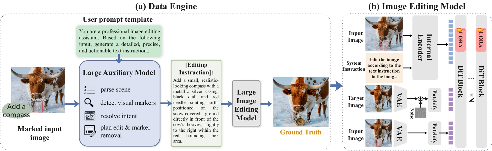
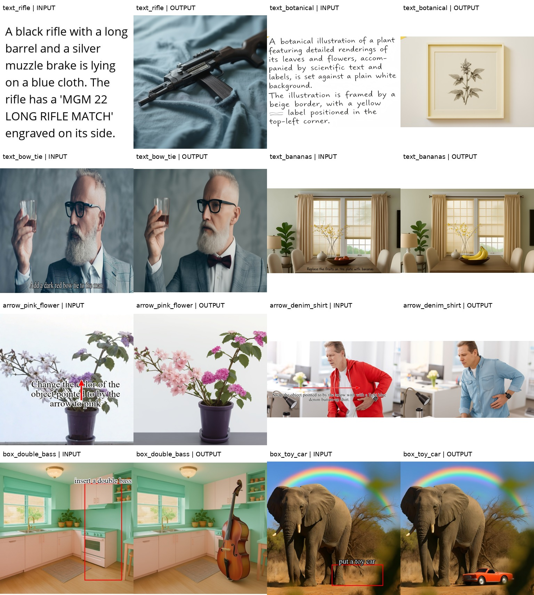

# Siphon

## Internalize External Competence for Visual Instruction Editing

**NeurIPS 2026**

[English](README.md) | [项目主页](https://wenjunhuang94.github.io/Siphon/) | [论文 PDF](docs/Siphon.pdf) | [OpenReview](https://openreview.net/forum?id=mKfQzVpQIM) | [NeurIPS](https://neurips.cc/virtual/2026/loc/sydney/poster/149907)

**Wenjun Huang\***、**Rui Zhao\***、Suyang Hou、Jiahao Tang、Wenjia Wang、Zhuobai Dong、**Alex Jinpeng Wang†**、**Hu Jian Guo†**

\* 共同第一作者；† 共同通讯作者。

Sun Yat-sen University; National University of Singapore; Central South University; Wuhan University; Shenzhen Research Institute of Sun Yat-Sen University.

Siphon 让编辑模型直接读取画在图像中的简短文字、箭头和框，完成相应生成或编辑，并清除指令标记。推理时使用经过 LoRA 适配的图像编辑模型，不需要外部 VLM 规划器。



### 当前发布范围

- [x] 论文和论文项目主页
- [x] 基于 LongCat-Image-Edit 的推理入口
- [x] 四类视觉指令各两组，共八组精选输入/输出示例
- [x] 单卡配对数据 LoRA 训练参考实现与两阶段配置
- [x] Siphon LoRA 权重的公开下载
- [ ] 数据集和完整数据合成流程

当前版本包含推理、演示样例和配对数据训练参考实现。生成示例图的 `10000` adapter 已在 [Hugging Face](https://huggingface.co/huangwenjun1994/Siphon-LongCat-LoRA) 公开，权重采用 Apache-2.0 许可。基座模型直接生成的结果应标为 LongCat baseline，不能称为 Siphon 结果。

权重下载、最小包导出及 Hub 上传工具见 [WEIGHTS.md](WEIGHTS.md)，checkpoint 身份与已观察到的限制见 [已发布的模型卡](https://huggingface.co/huangwenjun1994/Siphon-LongCat-LoRA)。

### 安装与单图推理

使用 Python 3.10 或 3.11，以及支持 CUDA 的 GPU：

```bash
python -m venv .venv
source .venv/bin/activate
python -m pip install -e .
```

依赖中的 Diffusers 固定到已记录的 Git commit；安装需要访问 GitHub 和 Python 包源。推理使用 LongCat-Image-Edit 基座与标准 PEFT adapter，不依赖原训练项目的目录结构或 API key。adapter 目录应包含 `adapter_config.json` 和 `adapter_model.safetensors`。

例如，读取厨房图中的红框和文字，在框内生成低音提琴：

```bash
python -m siphon.inference \
  --base-model meituan-longcat/LongCat-Image-Edit \
  --lora huangwenjun1994/Siphon-LongCat-LoRA \
  --input examples/inputs/box_double_bass.png \
  --task box_edit \
  --output outputs/single_box_double_bass.png
```

这里输入的是已经画好框、写好文字的整张图片。`--task` 提供通用任务提示词，具体“添加低音提琴”的要求由模型从图像中读取。

| 论文类型 | 输入形式 | `--task` |
| --- | --- | --- |
| I | 画布上渲染的场景描述文字 | `text_to_image` |
| II | 原图上渲染的编辑指令文字 | `text_edit` |
| III | 原图上的箭头和编辑指令 | `arrow_edit` |
| IV | 原图上的框和编辑指令 | `box_edit` |

`--base-model` 默认是 `meituan-longcat/LongCat-Image-Edit`；基座与 `--lora` 都支持本地目录或 Hugging Face ID。离线运行时，请指定已下载的本地模型目录，并加 `--local-files-only`。

使用 Hugging Face 上本次记录的基座快照时，加 `--revision 7b54ef423aa7854be7861600024be5c56ab7875a`。这个参数只指定基座版本，不指定 adapter 版本。

### 批量示例

运行全部八例：

```bash
python -m siphon.inference \
  --lora huangwenjun1994/Siphon-LongCat-LoRA \
  --examples examples/examples.json \
  --output-dir outputs
```

只运行指定样例，可重复使用 `--case`：

```bash
python -m siphon.inference \
  --lora huangwenjun1994/Siphon-LongCat-LoRA \
  --examples examples/examples.json \
  --case arrow_pink_flower --case box_double_bass \
  --output-dir outputs
```

默认参数为 `--steps 50 --guidance 4.5 --seed 43 --offload model`。首次开启 CPU offload 测试建议预留约 22 GB 空闲显存，实际占用受图像尺寸和软件版本影响；显存充足时可用 `--offload none`。

加 `--dry-run` 可在加载模型前检查任务列表；需要替换已有输出时加 `--overwrite`。安装后的 `siphon-infer` 命令与 `python -m siphon.inference` 等价。`--base-only` 明确运行不加载 adapter 的 LongCat baseline。完整参数见 `python -m siphon.inference --help`。

### 训练

[中文训练说明](TRAINING_zh-CN.md) 与 [English](TRAINING.md) 包含配对数据格式、冻结编码器/VAE 预缓存、两阶段配置、权重初始化、完整断点恢复及导出推理的方法。

```bash
python -m siphon.prepare_training_data --manifest data/stage1.jsonl \
  --revision 7b54ef423aa7854be7861600024be5c56ab7875a --cache-dir caches/stage1
python -m siphon.train --config configs/stage1.json
```

先准备自己的配对训练数据；`training/examples/` 的极小清单只用于跑通流程。训练说明区分了历史 `10000` adapter 和新的可移植缓存实现，不将后者宣传为论文全部结果的精确复现。完整 teacher 数据合成流程和原训练数据集仍未发布。

### 示例效果与范围



[八例说明与限制](examples/README.md) · [样例清单](examples/examples.json)

这些是为代码初版整理的精选研究演示，不能用来估计整体成功率。结果存在局限：箭头指向花朵变粉时，其他花朵也一起变粉；人物面容和背景纹理可能重绘；文字生图样例没有完整满足所有细节与标签要求。每例实际参数、资产哈希、来源记录和观察结论见清单。不同软件环境复跑不保证像素完全一致。

`examples/` 中的图片来自本次代码整理阶段的实际生成，`docs/` 中继续保留论文原图及原项目主页内容，两者分别记录。

代码使用 [Apache 2.0 许可](LICENSE)。已发布的 Siphon adapter 权重单独采用 [Apache-2.0 许可](https://huggingface.co/huangwenjun1994/Siphon-LongCat-LoRA/blob/main/LICENSE)。论文、论文图片、示例图片和基座模型权重保留各自条款。示例的部分原始图像归属和再分发记录尚待补充；具体来源记录见 [示例说明](examples/README.md#provenance) 和 [第三方说明](THIRD_PARTY_NOTICES.md)。

### 验证

CPU 检查命令为 `python -m unittest discover -s tests -v`。新推理入口已完成一次 A100 上的 50 步实机测试，训练参考实现也已跑通短程缓存、训练、断点恢复和导出后推理；环境、结果和验证范围见 [验证记录](VALIDATION.md)。

### 引用

```bibtex
@inproceedings{huang2026siphon,
  title     = {Internalize External Competence for Visual Instruction Editing},
  author    = {Wenjun Huang and Rui Zhao and Suyang Hou and
               Jiahao Tang and Wenjia Wang and Zhuobai Dong and
               Alex Jinpeng Wang and Hu Jian Guo},
  booktitle = {Advances in Neural Information Processing Systems},
  year      = {2026},
  url       = {https://openreview.net/forum?id=mKfQzVpQIM}
}
```

### 项目主页开发

主页位于 `docs/`，由静态 HTML、CSS 和 JavaScript 组成。可本地预览：

```bash
python -m http.server 8000 --directory docs
```

浏览器打开 http://localhost:8000。GitHub Pages 部署设置为 **Settings > Pages > Deploy from a branch > main > /docs**。

### 联系方式

- Wenjun Huang：huangwj98@mail2.sysu.edu.cn
- Alex Jinpeng Wang（共同通讯作者）：jinpengwang@csu.edu.cn
- Hu Jian Guo（共同通讯作者）：hujguo@mail.sysu.edu.cn
